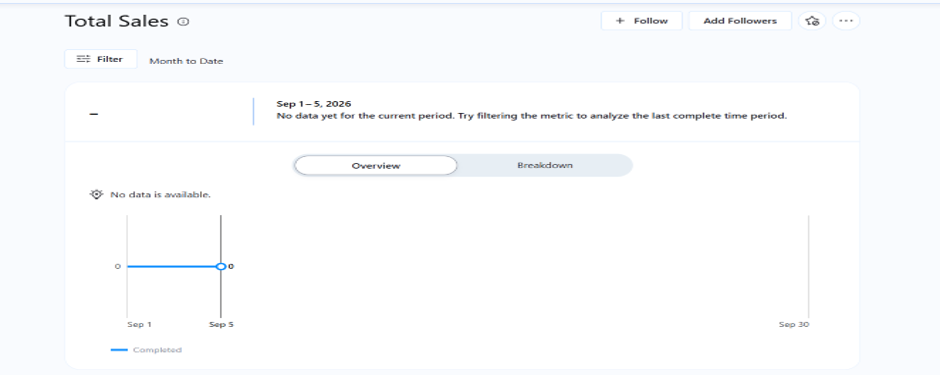
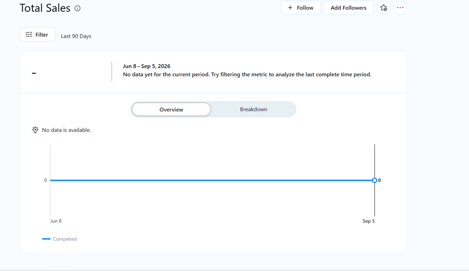
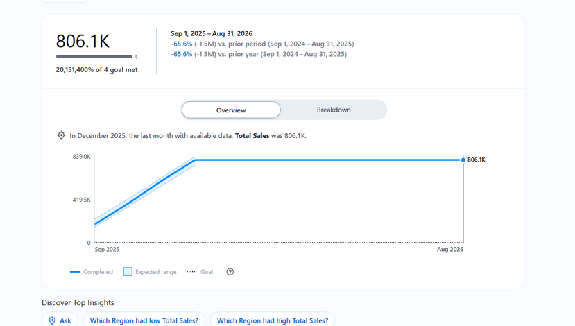
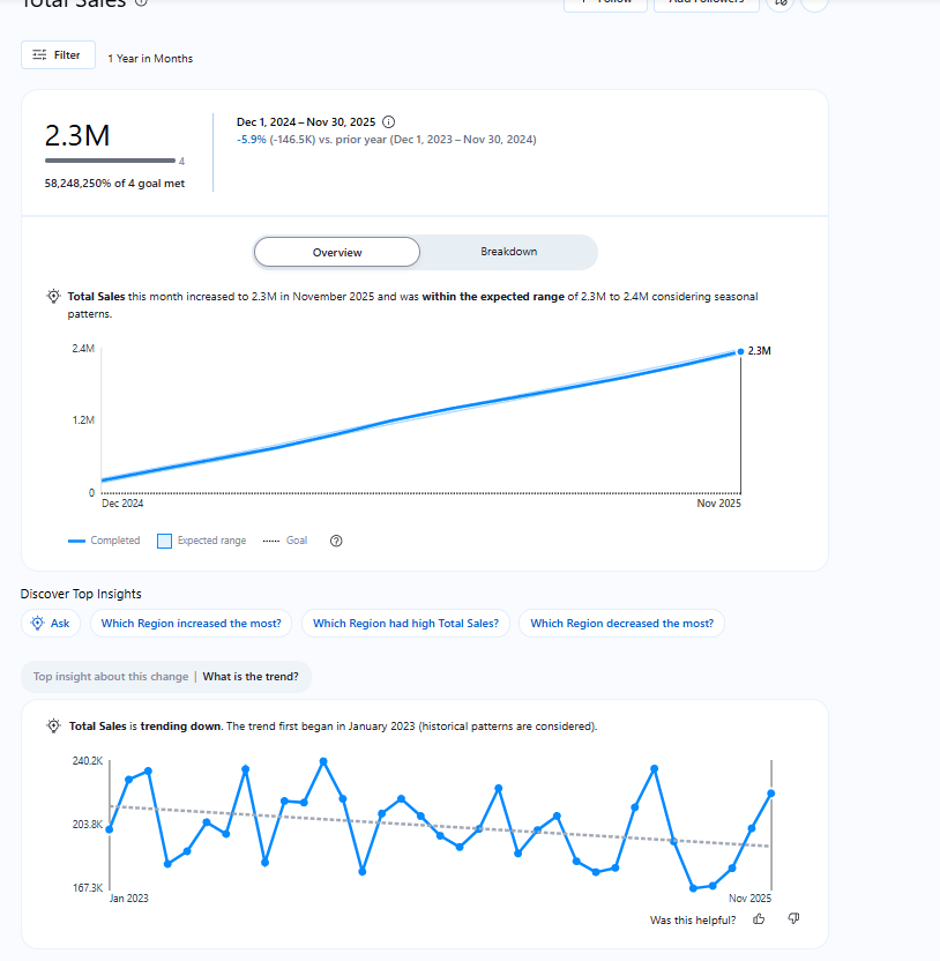

# The pattern that wasn't there

A critical evaluation of AI-generated insights in **Tableau Pulse**, tested against
manual analysis of a three-year retail sales dataset.

**The finding: Pulse did not discover a seasonal pattern — it assumed one, then
fitted an "expected range" around it.**

---

## The data

| | |
|---|---|
| Rows | 432 (36 months × 4 regions × 3 categories) |
| Period | January 2023 – December 2025 |
| Regions | North, South, East, West |
| Categories | Furniture, Office Supplies, Technology |
| Revenue | €7,300,882 |
| Profit | €1,179,077 |

Fields cover date, region, category, product line, sales, profit and units sold.
There is no customer, pricing or promotion context — so the data shows *what*
happened and can never show *why*.

---

## What Pulse reported

Configured on Sum of Sales, monthly, against prior year, Pulse produced three
unusable states before a manual filter corrected it.

### Absence drawn as zero

Pulse defaulted to the current month against a dataset ending December 2025. The
caption states plainly that there is no data — while the chart beneath draws a
line at zero.

Widening to 90 days did not help: the whole window still falls after the end of
the data, and the flat zero line now spans the full chart.

### A headline figure from incomparable periods

The first window to return a value spanned Sep 2025 – Aug 2026, of which only
**four months contain data**. Pulse reported a decline of **−65.6%** twice, in
identical styling, with no indication that the two periods compared were of
different effective lengths.

Note also `20,151,400% of 4 goal met` — an implausible figure that passed
unchallenged.

### The corrected comparison

Filtering to Dec 2024 – Nov 2025 places the whole window inside the data. The
true figure is **−5.9%**, consistent with the annual totals in the source.

> **−65.6% reported · −5.9% actual.** Both were presented with identical visual
> authority and no confidence interval.

---

## What the AI did well

Credit before critique:

1. **Accurate** — the corrected figure, −5.9%, matched the source data.
2. **Unrequested** — it found the downward trend and dated it to January 2023
   without being asked. Reaching the same conclusion manually required building a
   line chart and fitting a trend line.
3. **Relevant** — its suggested follow-up questions were analytically sensible.
4. **Honest about gaps** — missing data was flagged in plain language, even as the
   chart contradicted the caption.

---

## What the manual analysis found instead

**There is no seasonality in this data.** Monthly sales fluctuate around €203,000
between extremes of €167,000 and €240,000 with no discernible pattern. A typical
month sits €20,000 from the average — over twice the movement the trend produces
between one month and the next. 2023 peaked in December and troughed in April;
2025 peaked in May and troughed in July. Three observations per calendar month
cannot establish a season.

**The decline is real but gentle.** Annual totals fall in order: €2.53m, €2.45m,
€2.32m. The best-fit line drops around 9% over three years, but the points scatter
so widely that no trend at all is almost as good a fit.

**The decline is about price, not demand.** This is the finding Pulse never
surfaced, and the most decision-relevant one in the dataset:

- Profit margin holds steady at ~16% across regions, categories and years
- Unit volumes hold flat at ~16,000 units per year
- **Revenue per unit fell from ~€155 to ~€147**

Customers are buying the same number of items and generating less revenue each.
That points at pricing, discounting or product mix — not at collapsing demand.

---

## Five sources of bias in one output

| Source | In this case |
|---|---|
| **Dataset** | 36 synthetic monthly points, no pricing, promotion or market context |
| **Sampling** | Three observations per calendar month cannot establish a season |
| **Algorithmic** | The model assumes seasonality exists — it presumed a pattern, then fitted a range around it |
| **Selection** | Measure, granularity and comparison period were all chosen before any analysis ran |
| **Confirmation** | "Sales are declining" is a story a manager may already half-believe |

---

## Ethical dimensions

- **Transparency** — the seasonal model behind "expected range" is never shown.
- **Explainability** — the insight arrives as a conclusion, with no route back to
  the reasoning.
- **Accountability** — responsibility for acting on −65.6% would have been the
  analyst's alone.
- **Trustworthiness** — accurate and inaccurate figures looked identical.

---

## Recommendations

1. Show the data's coverage window on the metric itself.
2. Never draw absent data as zero — break the line.
3. State the model behind any claim, and report confidence.
4. **Treat automated insights as prompts, not conclusions.**

---

## Files

| File | Contents |
|---|---|
| `Retail_Sales_Performance_report.docx` | Dashboard design rationale, insights and reflection |
| `PartC_Pulse_Evidence.docx` | Annotated screenshot evidence of the Pulse configuration |
| `Presentation_Final.pdf` | Bias and ethics analysis, presented |
| `images/` | Pulse screenshots |

---

## Tools

Tableau Desktop · Tableau Pulse (Tableau Cloud) · Excel

## References

Gebru, T. *et al.* (2021) 'Datasheets for datasets', *Communications of the ACM*,
64(12), pp. 86–92.

Jones, B. (2019) *Avoiding Data Pitfalls*. Hoboken, NJ: John Wiley & Sons.

Kaur, H. *et al.* (2020) 'Interpreting interpretability', in *Proceedings of the
2020 CHI Conference on Human Factors in Computing Systems*. New York: ACM.

Pandey, A.V. *et al.* (2014) 'The persuasive power of data visualization', *IEEE
Transactions on Visualization and Computer Graphics*, 20(12), pp. 2211–2220.

Szafir, D.A. (2018) 'The good, the bad, and the biased', *Interactions*, 25(4),
pp. 26–33.

---

## Context

Produced for COMPIT907 *AI and Data Visualisation*, Level 9 Postgraduate Diploma
in Applied Artificial Intelligence, Atlantic Technological University Donegal.

The dataset is synthetic and supplied for the module. Its near-random structure —
constant margins, negligible correlation between sales and quantity — made it well
suited to testing whether an automated insight tool would report patterns that
were not there.
